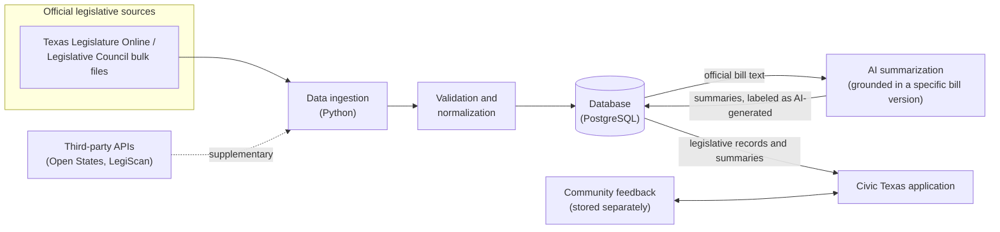

# Civic Texas

**Texas legislation, made accessible.**

Civic Texas is an independent, nonpartisan civic technology project that aims to make Texas state legislation easier to follow, read and understand. The planned platform will bring together legislative updates, plain-language bill summaries, original legislative documents and space for community feedback in one place.

**Status: Pre-launch, working proof of concept.** The public waitlist is live. The legislative application runs locally: it pulls a sample of real bills from official Texas records into a database, then shows them in a searchable directory with bill detail pages. The application is not deployed yet, and AI summaries are not connected to a model.

**Public waitlist:** https://rockysahooart.github.io/civictexas/

> Civic Texas is not affiliated with the State of Texas, the Texas Legislature, any government agency or any political party.

## Contents

1. [Mission](#mission)
2. [Planned features](#planned-features)
3. [Technology stack](#technology-stack)
4. [Legislative data sources](#legislative-data-sources)
5. [System architecture](#system-architecture)
6. [Accuracy and transparency](#accuracy-and-transparency)
7. [Repository structure](#repository-structure)
8. [Development roadmap](#development-roadmap)
9. [Getting started](#getting-started)
10. [Contributing](#contributing)
11. [Privacy and independence](#privacy-and-independence)
12. [License](#license)

## Mission

Civic Texas exists to narrow the distance between Texans and their state government. The project is guided by five commitments:

- **Legislative transparency.** Make it easy to see what has been filed, what has changed and where a bill stands, with links back to the official record.
- **Civic education.** Explain how the legislative process works and what a bill would do, without assuming prior knowledge.
- **Accessibility.** Write in plain language and build to recognized accessibility standards so the information is usable by as many people as possible.
- **Informed participation.** Give people the context they need to form their own views and take part in public conversations.
- **Political neutrality.** Present legislation without endorsing or opposing it, and without attributing motives to its authors.

## Planned features

| Feature | Current state |
| --- | --- |
| Near-real-time Texas legislative updates | Scheduled sync built, not running in production. Official files refresh about daily, so updates will not be real-time. |
| Searchable bill directory | **Working locally** with a sample of 89th and 90th Legislature bills |
| Plain-language, source-grounded bill summaries | Validation, review workflow and evaluation built. No model connected. |
| Original legislative documents | **Working locally**: full text of every stored version, plus official HTML/PDF links |
| Legislative status and voting history | **Working locally**: status, full action history, committee vote tallies and record vote references. Member-level votes are not available yet. |
| Bill amendments and version comparisons | Every version is stored, with added and deleted text marked. A side-by-side comparison is planned. |
| Legislative impact explanations | Planned, as part of summaries |
| Personalized bill tracking and notifications | Database tables only |
| Community feedback and discussions | Database tables only |
| Transparent sourcing and AI accuracy reporting | **Working locally**: sources and sync times on every bill, plus anonymous error reports |

## Technology stack

| Area | Technology | Status |
| --- | --- | --- |
| Waitlist page | HTML, CSS, JavaScript (no framework) | **Implemented** |
| Waitlist hosting | GitHub Pages | **Implemented** |
| Waitlist signups | External form service (for example, Formspree) | Integration point built; no service connected yet |
| Frontend | Next.js 15, React 19, TypeScript | **Implemented** (local) |
| Styling | Tailwind CSS 4, shadcn/ui | **Implemented** |
| Database | PostgreSQL 16 locally. Supabase in production. | **Implemented** locally. Supabase project not created yet. |
| Authentication | Supabase Auth | Proposed (schema and RLS ready) |
| Data ingestion | Python (standard library plus `psycopg`) | **Implemented** |
| Legislative data | Texas Legislative Council bulk files (official) | **Implemented**. Open States and LegiScan are planned as supplements. |
| AI summarization | Provider-agnostic interface | Architecture **implemented**. No provider connected. |
| Search | PostgreSQL full-text search | **Implemented** |
| Automation | GitHub Actions | CI **implemented**. Scheduled sync inactive until a database secret is added. |
| Application hosting | Vercel | Proposed |

Deviations from the proposed stack, and the reasons for them, are documented in [docs/architecture.md](docs/architecture.md#deviations-from-the-proposed-stack).

## Legislative data sources

| Source | What it is |
| --- | --- |
| [Texas Legislature Online](https://capitol.texas.gov/) | The Legislature's official website for bills, actions, committees and members. |
| [Texas Legislative Council bulk downloads](https://capitol.texas.gov/billlookup/filedownloads.aspx) | Official bulk files: bill history, bill text, fiscal notes and analyses, organized by legislative session. |
| [Open States API](https://docs.openstates.org/api-v3/) | A third-party API with structured state legislative data. Requires a free API key. |
| [LegiScan](https://legiscan.com/) | A third-party legislative tracking service with an API. Requires registration. |
| [LegiScan Texas datasets](https://legiscan.com/TX/datasets) | Downloadable LegiScan datasets for Texas sessions. |

**Official Texas legislative records are the authoritative source of truth.** Open States and LegiScan are useful for structured data and supplementary infrastructure, but they repackage official records. They are not independent legislative authorities. Where a third-party record disagrees with the official record, the official record wins.

The application currently uses only the official Texas Legislative Council bulk files. It does not scrape websites, it spaces its requests at least one second apart, and it shows the source and disclaimer on every bill. Third-party sources would plug into the same provider interface. A detailed comparison of all five sources is in [docs/data-sources.md](docs/data-sources.md).

## System architecture

Everything except the AI model works locally today. Details are in [docs/architecture.md](docs/architecture.md).



Community feedback is kept apart from legislative records and generated summaries. It is stored in separate tables, shown in separate parts of the interface, and never used as an input to bill data or summaries.

## Accuracy and transparency

These are the standards the project holds itself to. Where a standard is already enforced in code, the item says so.

- **Source-grounded AI summarization.** Summaries will be generated from the text of a specific official bill version, not from a title or description alone. AI-generated summaries can contain errors. They will be clearly labeled and will never be presented as guaranteed to be accurate.
- **Direct citations.** Summary statements will point to the bill sections they are based on, and those citations will be checked against the source text.
- **Bill version tracking.** Enforced: every version is stored, changed text is saved as a new snapshot instead of overwriting the old one (a database trigger blocks edits), and summaries of outdated text are automatically withdrawn.
- **Data freshness.** Enforced: each bill shows when it was last synchronized and when the source last changed it, and records past the freshness threshold are flagged. The application does not claim real-time updates.
- **Political neutrality.** Summaries will not recommend supporting or opposing legislation and will not infer political motives.
- **Human review and error reporting.** Summaries are public only after a person approves them (enforced by row-level security). Anyone can report an error on a bill or summary without an account.
- **Proposed versus enacted law.** Statuses come from the official action history using published rules, and each status carries a plain explanation that never calls proposed legislation law. Summary validation rejects "now law" wording for bills that aren't enacted.
- **Facts, interpretations and opinions.** Official legislative facts, AI-generated explanations and community opinions will be visually and structurally separated.

## Repository structure

```
.
├── index.html, styles.css, script.js, assets/   # Public waitlist (GitHub Pages, unchanged)
├── .nojekyll                     # Pages serves files as-is
├── web/                          # Application (Next.js)
│   └── src/
│       ├── app/                  # Routes: /, /bills, /bills/[session]/[billId], /about, /methodology
│       ├── components/           # Status badge, bill text, notices, shadcn/ui components
│       └── lib/                  # Database access, queries, search parsing, status labels
├── ingestion/                    # Legislative data ingestion (Python)
│   ├── civictexas_ingest/        # Providers, parsing, status mapping, sync
│   ├── sample_bills.json         # The proof-of-concept bill sample
│   └── tests/                    # Unit, database and RLS tests; official record fixtures
├── summarization/                # AI summarization (Python)
│   ├── civictexas_summarize/     # Schema, prompt, provider interface, validation, review
│   ├── evals/cases.json          # Evaluation dataset
│   └── tests/
├── supabase/
│   ├── migrations/               # Database schema, indexes, triggers, RLS
│   └── local/                    # Local-only Supabase stand-in for plain PostgreSQL
├── scripts/dev-db.sh             # Start, reset and stop the local database
├── docs/                         # Architecture, data sources, deployment, summarization, roadmap
├── .github/workflows/            # CI and scheduled sync
├── .env.example                  # Every environment variable, without real values
└── pytest.ini
```

The waitlist and the application are independent. The waitlist is static files at the root, served by GitHub Pages. The application lives in `web/` and will be hosted separately on Vercel. Neither depends on the other.

## Development roadmap

Items are checked only when their implementation has been verified.

### Phase 1: Project foundation

- [x] Repository initialization
- [x] README documentation
- [x] GitHub Pages deployment
- [ ] Public waitlist (page is live; signup collection is not connected to a form service yet)

### Phase 2: Legislative data infrastructure

- [x] Data source research ([docs/data-sources.md](docs/data-sources.md))
- [x] Official data integration (Texas Legislative Council bulk files). Open States and LegiScan are not integrated.
- [x] Database architecture (migrations, RLS, tested on PostgreSQL 16)
- [ ] Automated bill synchronization (sync job verified locally; scheduled workflow not yet active)

### Phase 3: Legislative explorer

- [x] Search and filtering (verified locally, not deployed)
- [x] Bill detail pages (verified locally, not deployed)
- [x] Legislative status tracking
- [x] Original document viewing

### Phase 4: AI-powered comprehension

- [ ] Plain-language summarization (no model connected)
- [ ] Source citations (citation checking built and tested; no real summaries yet)
- [ ] Accuracy evaluation (harness and starter dataset built; no model evaluated yet)
- [ ] Bill version comparisons

### Phase 5: Personalization

- [ ] User accounts
- [ ] Saved bills
- [ ] Legislative notifications

### Phase 6: Community engagement

- [ ] Bill-specific discussions
- [ ] Community feedback
- [ ] Content moderation
- [x] Reporting mechanisms (anonymous error reports on bills and summaries; no moderation queue yet)

## Getting started

### Clone the repository

```bash
git clone https://github.com/rockysahooart/civictexas.git
cd civictexas
```

### The waitlist

The waitlist has no dependencies. Serve the repository root and open http://localhost:8000:

```bash
python3 -m http.server 8000
```

Signups need a form service. Paste its endpoint into `WAITLIST_ENDPOINT` at the top of [`script.js`](script.js). Until then, the form says signups aren't open and never pretends a signup worked. Subscriber emails are held by the form service and never stored in this repository.

### The application

You need Node.js 22, Python 3.9 or newer, and PostgreSQL 16. On macOS with Homebrew:

```bash
brew install node@22 postgresql@16
```

`node@22` is not added to your PATH automatically. Add it for the current shell:

```bash
export PATH="$(brew --prefix node@22)/bin:$PATH"
```

**1. Configure environment variables.** Every variable is listed in [`.env.example`](.env.example), and the defaults work for local development. The ingestion commands read variables from your shell. The web app reads `web/.env.local`:

```bash
printf 'DATABASE_URL=postgresql://postgres@localhost:54329/civictexas\n' > web/.env.local
```

**2. Start a local database and apply the migrations.** It runs on port 54329, with data in `.local/` (git-ignored).

```bash
scripts/dev-db.sh start
```

```bash
scripts/dev-db.sh reset
```

**3. Load real bills from the official source.** This takes about three minutes because requests are spaced out.

```bash
python3 -m venv ingestion/.venv && ingestion/.venv/bin/pip install -r ingestion/requirements-dev.txt
```

```bash
cd ingestion && export DATABASE_URL=postgresql://postgres@localhost:54329/civictexas && .venv/bin/python -m civictexas_ingest sync --session 89R --mode sample && .venv/bin/python -m civictexas_ingest sync --session 90R --mode sample
```

Other modes: `--mode incremental` (only bills changed since the last run) and `--mode full --limit 50`.

**4. Run the web app** at http://localhost:3000:

```bash
cd web && npm install && npm run dev
```

### Tests

```bash
TEST_DATABASE_ADMIN_URL=postgresql://postgres@localhost:54329/postgres ingestion/.venv/bin/python -m pytest
```

```bash
cd summarization && ../ingestion/.venv/bin/python -m civictexas_summarize.evaluate
```

```bash
cd web && npm run lint && npm run typecheck && npm test && npm run build
```

The database tests create and drop throwaway databases (`civictexas_test`, `civictexas_sumtest`). They are skipped when `TEST_DATABASE_ADMIN_URL` is not set.

### GitHub Pages deployment

The waitlist is published from the **`main`** branch, **root (`/`)** folder, at https://rockysahooart.github.io/civictexas/. Every push to `main` redeploys it. The setting is under **Settings → Pages** on GitHub.

### Deploying the application

Not done yet. [docs/deployment.md](docs/deployment.md) covers Supabase, the scheduled sync and Vercel. Each uses a free tier and needs an account owner to set it up.

## Contributing

Contributions are welcome. Because this project deals with public information about government, a few standards matter more than usual.

- **Reporting bugs.** Open a [GitHub issue](https://github.com/rockysahooart/civictexas/issues) describing what happened, what you expected, and how to reproduce it. Include your browser and device for display problems.
- **Proposing features.** Open an issue that explains the problem the feature solves and who it helps. Check the [roadmap](#development-roadmap) first.
- **Submitting pull requests.** Fork the repository, create a branch, keep changes focused, and describe what you changed and how you tested it. Link the related issue.
- **Maintaining political neutrality.** Do not add content, wording or design that favors or opposes a party, candidate, legislator or position.
- **Protecting user privacy.** Never commit personal information, subscriber emails, API keys or other credentials. Collect only the data a feature needs.
- **Ensuring legislative accuracy.** Cite official sources for legislative information. Never invent bill data. Clearly label any test fixtures or sample data as such.
- **Following accessibility standards.** Aim for [WCAG 2.2](https://www.w3.org/TR/WCAG22/) level AA: semantic HTML, keyboard support, visible focus and sufficient color contrast.

## Privacy and independence

- Civic Texas is an independent civic technology initiative.
- Civic Texas is not affiliated with the Texas state government, the Texas Legislature or any political party.
- Legislative summaries are for general information only and do not constitute legal advice.
- Community contributions represent the opinions of the individuals who post them, not Civic Texas.
- Personal information and API credentials must never be committed to this repository.

## License

**No license has been selected yet.** This is a pending decision. Until a license is added, the default copyright rules apply: the code is publicly visible, but others do not have permission to reuse, modify or distribute it. A license will be chosen and added to this section and to a `LICENSE` file once it is decided.
