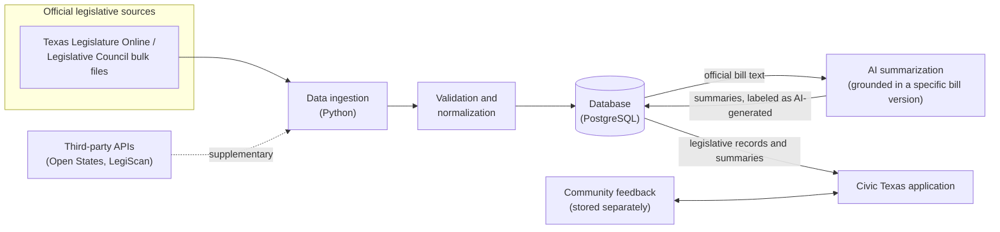

# Civic Texas

**Texas legislation, made accessible.**

Civic Texas is an independent, nonpartisan civic technology project that aims to make Texas state legislation easier to follow, read and understand. The planned platform will bring together legislative updates, plain-language bill summaries, original legislative documents and space for community feedback in one place.

**Status: Pre-launch.** The only thing built so far is a static waitlist page. The legislative application has not been built yet.

**Public waitlist:** https://rockysahooart.github.io/civictexas/

> Civic Texas is not affiliated with the State of Texas, the Texas Legislature, any government agency or any political party.

## Contents

1. [Mission](#mission)
2. [Planned features](#planned-features)
3. [Technology stack](#technology-stack)
4. [Legislative data sources](#legislative-data-sources)
5. [System architecture](#system-architecture)
6. [Accuracy and transparency](#accuracy-and-transparency)
7. [Repository structure](#repository-structure)
8. [Development roadmap](#development-roadmap)
9. [Getting started](#getting-started)
10. [Contributing](#contributing)
11. [Privacy and independence](#privacy-and-independence)
12. [License](#license)

## Mission

Civic Texas exists to narrow the distance between Texans and their state government. The project is guided by five commitments:

- **Legislative transparency.** Make it easy to see what has been filed, what has changed and where a bill stands, with links back to the official record.
- **Civic education.** Explain how the legislative process works and what a bill would do, without assuming prior knowledge.
- **Accessibility.** Write in plain language and build to recognized accessibility standards so the information is usable by as many people as possible.
- **Informed participation.** Give people the context they need to form their own views and take part in public conversations.
- **Political neutrality.** Present legislation without endorsing or opposing it, and without attributing motives to its authors.

## Planned features

None of these features exist yet. They describe what the project intends to build.

- Near-real-time Texas legislative updates
- Searchable bill directory
- Plain-language, source-grounded bill summaries
- Original legislative documents
- Legislative status and voting history
- Bill amendments and version comparisons
- Legislative impact explanations
- Personalized bill tracking and notifications
- Community feedback and discussions
- Transparent sourcing and AI accuracy reporting

## Technology stack

| Area | Technology | Status |
| --- | --- | --- |
| Waitlist page | HTML, CSS, JavaScript (no framework) | **Implemented** |
| Waitlist hosting | GitHub Pages | **Implemented** |
| Waitlist signups | External form service (for example, Formspree) | Integration point built; no service connected yet |
| Frontend | Next.js, React, TypeScript | Proposed |
| Styling | Tailwind CSS, shadcn/ui | Proposed |
| Database | PostgreSQL, Supabase | Proposed |
| Authentication | Supabase Auth | Proposed |
| Data ingestion | Python | Proposed |
| Legislative data | Texas Legislature Online, Open States, LegiScan | Proposed |
| AI summarization | Provider-agnostic LLM integration | Proposed |
| Search | PostgreSQL full-text search | Proposed |
| Automation | GitHub Actions | Proposed |
| Application hosting | Vercel | Proposed |

Proposed choices may change as the project develops. Any change will be documented here before it is implemented.

## Legislative data sources

| Source | What it is |
| --- | --- |
| [Texas Legislature Online](https://capitol.texas.gov/) | The Legislature's official website for bills, actions, committees and members. |
| [Texas Legislative Council bulk downloads](https://capitol.texas.gov/billlookup/filedownloads.aspx) | Official bulk files: bill history, bill text, fiscal notes and analyses, organized by legislative session. |
| [Open States API](https://docs.openstates.org/api-v3/) | A third-party API with structured state legislative data. Requires a free API key. |
| [LegiScan](https://legiscan.com/) | A third-party legislative tracking service with an API. Requires registration. |
| [LegiScan Texas datasets](https://legiscan.com/TX/datasets) | Downloadable LegiScan datasets for Texas sessions. |

**Official Texas legislative records are the authoritative source of truth.** Open States and LegiScan are useful for structured data and supplementary infrastructure, but they repackage official records. They are not independent legislative authorities. Where a third-party record disagrees with the official record, the official record wins.

The project will prefer official bulk downloads and documented APIs over scraping websites, and will follow each provider's terms, rate limits and attribution requirements. A detailed comparison of these sources is planned as part of Phase 2.

## System architecture

This is the **proposed** architecture. None of it beyond the waitlist exists yet.



Community feedback is kept apart from legislative records and generated summaries. It is stored in separate tables, shown in separate parts of the interface, and never used as an input to bill data or summaries.

## Accuracy and transparency

These are the standards the project intends to meet. They are goals for the application, not claims about software that exists today.

- **Source-grounded AI summarization.** Summaries will be generated from the text of a specific official bill version, not from a title or description alone. AI-generated summaries can contain errors. They will be clearly labeled and will never be presented as guaranteed to be accurate.
- **Direct citations.** Summary statements will point to the bill sections they are based on, and those citations will be checked against the source text.
- **Bill version tracking.** Each version of a bill (introduced, engrossed, enrolled and so on) will be stored. Earlier text will not be silently overwritten, and summaries will be regenerated when the underlying text changes.
- **Data freshness.** Each bill will show when its data was last synchronized with the source. The application will not advertise real-time updates unless it actually provides and verifies them.
- **Political neutrality.** Summaries will not recommend supporting or opposing legislation and will not infer political motives.
- **Human review and error reporting.** Summaries will go through a review workflow, and readers will be able to report inaccuracies.
- **Proposed versus enacted law.** Bills will always be described according to their actual status. Proposed legislation will never be described as law.
- **Facts, interpretations and opinions.** Official legislative facts, AI-generated explanations and community opinions will be visually and structurally separated.

## Repository structure

### Current

```
.
├── index.html       # Waitlist landing page (served by GitHub Pages)
├── styles.css       # Waitlist page styles
├── script.js        # Waitlist email validation and form submission
├── assets/
│   └── favicon.svg  # Site icon
├── .gitignore
└── README.md
```

### Proposed

This layout is a plan and will be refined when the application is set up. The waitlist files stay at the repository root so the GitHub Pages site keeps working.

```
.
├── index.html, styles.css, script.js, assets/   # Public waitlist (GitHub Pages)
├── app/              # Application frontend (Next.js)
├── ingestion/        # Legislative data ingestion (Python)
├── supabase/
│   └── migrations/   # Database migrations
├── summarization/    # AI summarization interface, prompts and evaluation data
├── tests/            # Cross-cutting and end-to-end tests
└── docs/             # Architecture, data source and deployment documentation
```

## Development roadmap

Items are checked only when their implementation has been verified.

### Phase 1: Project foundation

- [x] Repository initialization
- [x] README documentation
- [x] GitHub Pages deployment
- [ ] Public waitlist (page is live; signup collection is not connected to a form service yet)

### Phase 2: Legislative data infrastructure

- [ ] Data source research
- [ ] API integration
- [ ] Database architecture
- [ ] Automated bill synchronization

### Phase 3: Legislative explorer

- [ ] Search and filtering
- [ ] Bill detail pages
- [ ] Legislative status tracking
- [ ] Original document viewing

### Phase 4: AI-powered comprehension

- [ ] Plain-language summarization
- [ ] Source citations
- [ ] Accuracy evaluation
- [ ] Bill version comparisons

### Phase 5: Personalization

- [ ] User accounts
- [ ] Saved bills
- [ ] Legislative notifications

### Phase 6: Community engagement

- [ ] Bill-specific discussions
- [ ] Community feedback
- [ ] Content moderation
- [ ] Reporting mechanisms

## Getting started

### Clone the repository

```bash
git clone https://github.com/rockysahooart/civictexas.git
cd civictexas
```

### Install dependencies

There is nothing to install. The waitlist is plain HTML, CSS and JavaScript with no packages or build step.

### Configure environment variables

None are needed yet. The waitlist's only setting is the form service address, `WAITLIST_ENDPOINT`, at the top of [`script.js`](script.js). It is a public URL, not a secret, because it is sent to every visitor's browser.

To turn on signups:

1. Create a form with a form service such as [Formspree](https://formspree.io).
2. Paste its endpoint into `WAITLIST_ENDPOINT` in [`script.js`](script.js).
3. In the form service's settings, restrict submissions to `rockysahooart.github.io`.
4. Commit, push and send a test signup from the live site.

Until an endpoint is set, the form checks the email address but tells visitors that signups aren't open yet. It never pretends a signup succeeded. Subscriber emails are held by the form service and never stored in this repository.

### Run locally

Serve the repository root with any static file server. For example, with Python:

```bash
python3 -m http.server 8000
```

Then open http://localhost:8000.

### GitHub Pages deployment

The waitlist is published from the **`main`** branch, **root (`/`)** folder, at https://rockysahooart.github.io/civictexas/. Every push to `main` redeploys it, usually within a couple of minutes. The setting is under **Settings → Pages** on GitHub.

### Future instructions (not yet available)

The application, database and ingestion pipeline do not exist yet, so there are no commands for them. When they are added, this section will cover installing Node.js and Python dependencies, setting up a local Supabase database, creating a `.env.local` file from an `.env.example` template, and running the ingestion and development servers.

## Contributing

Contributions are welcome. Because this project deals with public information about government, a few standards matter more than usual.

- **Reporting bugs.** Open a [GitHub issue](https://github.com/rockysahooart/civictexas/issues) describing what happened, what you expected, and how to reproduce it. Include your browser and device for display problems.
- **Proposing features.** Open an issue that explains the problem the feature solves and who it helps. Check the [roadmap](#development-roadmap) first.
- **Submitting pull requests.** Fork the repository, create a branch, keep changes focused, and describe what you changed and how you tested it. Link the related issue.
- **Maintaining political neutrality.** Do not add content, wording or design that favors or opposes a party, candidate, legislator or position.
- **Protecting user privacy.** Never commit personal information, subscriber emails, API keys or other credentials. Collect only the data a feature needs.
- **Ensuring legislative accuracy.** Cite official sources for legislative information. Never invent bill data. Clearly label any test fixtures or sample data as such.
- **Following accessibility standards.** Aim for [WCAG 2.2](https://www.w3.org/TR/WCAG22/) level AA: semantic HTML, keyboard support, visible focus and sufficient color contrast.

## Privacy and independence

- Civic Texas is an independent civic technology initiative.
- Civic Texas is not affiliated with the Texas state government, the Texas Legislature or any political party.
- Legislative summaries are for general information only and do not constitute legal advice.
- Community contributions represent the opinions of the individuals who post them, not Civic Texas.
- Personal information and API credentials must never be committed to this repository.

## License

**No license has been selected yet.** This is a pending decision. Until a license is added, the default copyright rules apply: the code is publicly visible, but others do not have permission to reuse, modify or distribute it. A license will be chosen and added to this section and to a `LICENSE` file once it is decided.
