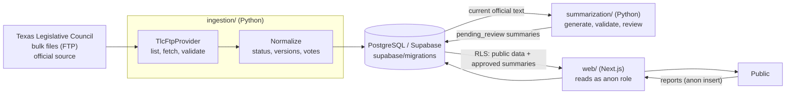

# Architecture

Status: proof of concept, verified locally on 2026-11-26. Nothing below is deployed yet except the waitlist.

## Data flow

## Components

| Directory | What it does |
| --- | --- |
| `index.html`, `styles.css`, `script.js`, `assets/` | The public waitlist, served by GitHub Pages. Unchanged by the application. `.nojekyll` makes Pages serve files as-is. |
| `supabase/migrations/` | Schema, indexes, triggers and row-level security. Plain SQL, compatible with the Supabase CLI. |
| `supabase/local/supabase_shim.sql` | Local development only. Recreates Supabase's `auth.uid()` and roles on plain PostgreSQL. |
| `ingestion/` | Python 3.9+ package `civictexas_ingest`. Provider interface, the official TLC provider, status mapping, text extraction, sync orchestration. Only runtime dependency: `psycopg`. |
| `summarization/` | Python package `civictexas_summarize`. Structured summary schema, prompt, provider interface, citation validator, review workflow, evaluation dataset. No model provider is configured. |
| `web/` | Next.js 15 (App Router), TypeScript, Tailwind CSS 4, shadcn/ui. Server components query PostgreSQL directly. |
| `.github/workflows/` | `ci.yml` (tests, lint, build) and `sync.yml` (scheduled incremental sync, inactive until a `DATABASE_URL` secret exists). |

## Key design decisions

**Official records are authoritative.** The only implemented provider reads the Texas Legislative Council's bulk files, which the Council publishes for automated users. Third-party sources plug into the same `LegislativeProvider` interface (`ingestion/civictexas_ingest/providers/base.py`) and are marked `is_authoritative = false`. See [data-sources.md](data-sources.md).

**Bill identity is session-scoped.** `bills` is unique on `(session_id, bill_type, bill_number)`. URLs are `/bills/{session}/{billId}`, e.g. `/bills/89R/HB2`.

**Official text is never overwritten.** Each download of a document is hashed. Unchanged content is not stored again. Changed content becomes a new `source_documents` row with `supersedes_id`, the old row is kept with `is_current = false`, and a trigger blocks edits to stored content.

**Status is derived, not guessed.** `ingestion/civictexas_ingest/status.py` maps the official action history to a normalized status with explicit rules, including the cases that are easy to get wrong:

- second-reading steps ("Passed to engrossment") are not final passage
- clerical steps ("Reported engrossed") are not committee reports
- a bill amended by the second chamber has not passed until the first chamber concurs or both adopt a conference report (89R HB 4 is a real test case)
- bills that hadn't finished when a session ended are shown as not passed
- unmatched histories are `unknown`

The web app, Python pipeline and database constraint share one status list, and a test checks they match.

**Facts, AI explanations and community content are separated** in separate tables (`bills` and related; `ai_summaries`; `comments`, `content_reports`) and in separate parts of the page. Community tables never feed the others. There are no popularity columns.

**Row-level security is the access model.** Public legislative tables are readable by `anon`, with no write policies. `ai_summaries` are visible to the public only when `review_status = 'approved'`. Users can read and change only their own saved bills and profile (but not their role). Anyone can file a report without an account. The web app runs every query inside a transaction that does `set local role anon`, so it gets exactly the public view even though it connects with a privileged connection string.

**Freshness is shown, not implied.** Every bill stores `source_updated_at` (from the source) and `last_synced_at` (when we last confirmed it). Pages show both and warn when a record is older than `NEXT_PUBLIC_STALE_AFTER_HOURS`. Every run is logged in `sync_runs` with counts and per-bill errors. `sync_state` keeps the incremental cursor, which only advances when every bill in the run succeeded.

## Ingestion details

| Requirement | Implementation |
| --- | --- |
| Retrieval | `Fetcher` (stdlib `urllib`, works for `ftp://` and `https://`) |
| Pagination | Directory listings per range folder (`HB00100_HB00199`), each one page of up to 100 bills |
| Validation | `parse_bill_xml` rejects wrong root elements, unknown bill identifiers, missing captions, bad dates and mismatched bills |
| Normalization | `NormalizedBill` dataclasses, provider-neutral |
| Duplicate prevention | Natural keys with `on conflict`, plus a content hash per bill record and per document |
| Incremental sync | `history.xml` change index plus a cursor in `sync_state` |
| Rate limiting | At least `INGEST_REQUEST_INTERVAL_SECONDS` between requests (default 1s) |
| Retries | Exponential backoff with jitter for transient errors. Missing files (404 / FTP 550) are not retried. |
| Error logging | Per-bill errors in `sync_runs.errors`. One bad record doesn't stop the run. |
| Attribution | `data_sources` table, shown on every bill page |
| Version detection | `bill_versions` from the history XML, plus a content hash per document snapshot |
| Configurable frequency | Cron in `sync.yml` and `SYNC_MIN_INTERVAL_MINUTES` |

## Deviations from the proposed stack

| Proposed | Implemented | Why |
| --- | --- | --- |
| Supabase client for data access | Direct PostgreSQL from server components (`postgres` driver), as `anon` | Full-text ranking and multi-filter queries are simpler in SQL, and RLS still applies. Works with Supabase's connection pooler. Supabase Auth will use `@supabase/ssr` when accounts are added. |
| Supabase for local development | Plain PostgreSQL 16 plus a small shim | The Supabase CLI needs Docker, which isn't required now. The migrations are unchanged and work on Supabase. |
| shadcn/ui throughout | shadcn Button, Input, Badge, Alert, Skeleton. Native `<select>` for filters. | Native selects work without JavaScript inside a GET search form and are more accessible on mobile. |
